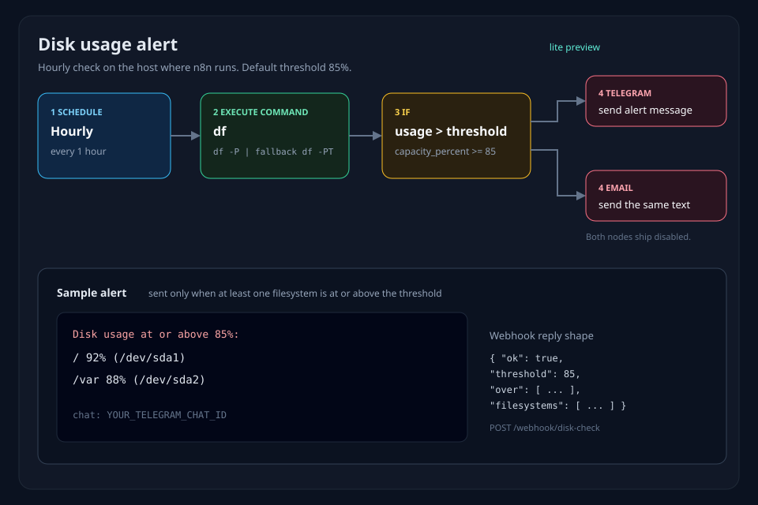

# Linux/Server Ops n8n Starter Pack — Free Lite Preview

## English

This repository is the free lite preview of the Linux/Server Ops n8n Starter Pack. It contains one importable workflow: a disk-usage alert. The paid pack adds two more workflows, bilingual prompt templates, a setup guide, sample payloads, and an acceptance test.

The workflow uses built-in n8n nodes only. The JSON stores credential names, not secrets. Chat id and mailbox fields are placeholders (`YOUR_TELEGRAM_CHAT_ID`, `alerts@example.com`, `ops@example.com`).

### Lite vs paid pack

| | Free lite (this repo) | Paid Starter Pack |
| --- | --- | --- |
| Disk-usage alert | yes | yes |
| Multi-domain SSL-expiry daily check | no | yes |
| Backup-failure alert | no | yes |
| 6 prompt templates, English and Chinese | no | yes |
| SETUP guide, sample data, acceptance test | no | yes |
| Price | free, MIT | $1 or more, suggested $3 |

A separate product, the full n8n DevOps Automation Pack, is $9: [https://caoyadong.gumroad.com/l/yvmcqj](https://caoyadong.gumroad.com/l/yvmcqj).

### What the disk-usage workflow does

`workflows/01_disk_usage_alert.json` runs on an hourly schedule, from a Manual Trigger, or from `POST /webhook/disk-check`.

1. A Set node holds `threshold_percent` (default **85**).
2. Execute Command runs `df -P -x tmpfs -x devtmpfs`. On BusyBox `df` (the official n8n image) `-x` is missing, so the same node falls back to `df -PT`. The Code node drops `tmpfs` and `devtmpfs` either way.
3. A filesystem is over the threshold when `capacity_percent` is at or above the Set value.
4. The over branch goes to Telegram, then Email. Both nodes ship **disabled**.
5. The webhook branch always responds with JSON. Schedule and manual runs do not call Respond to Webhook.

`df` reports the machine n8n is running on. Inside Docker that is the container filesystem. Run n8n on the host when you want the host disks.

### Quick start

Minimum version: **n8n 2.0**. Checked on **n8n 2.43**. n8n 2 does not load Execute Command unless you clear the exclude list.

```bash
docker run -it --rm -p 5678:5678 \
  -e 'NODES_EXCLUDE=[]' \
  -e GENERIC_TIMEZONE=UTC \
  -v n8n_data:/home/node/.n8n \
  n8nio/n8n
```

Open the editor on port 5678 and finish the owner form. `GENERIC_TIMEZONE` is the clock for the hourly check. Set it to your zone, for example `UTC`.

`df` runs where n8n runs. The official image is Alpine BusyBox, which has no `df -x`. The workflow already falls back to `df -PT`. Keep `NODES_EXCLUDE=[]` only on an instance you trust. Execute Command can run a shell on that host.

**Import.** In the editor: workflow menu, Import from File, and pick `workflows/01_disk_usage_alert.json`.

From the CLI, on a machine that has this repo and a configured n8n data directory:

```bash
n8n import:workflow --separate --input=./workflows
```

With the official image:

```bash
docker run --rm \
  -e 'NODES_EXCLUDE=[]' \
  -v "$PWD/workflows:/wf" \
  -v n8n_data:/home/node/.n8n \
  n8nio/n8n import:workflow --separate --input=/wf
```

**Threshold.** Open the Set node named Set Threshold. `threshold_percent` defaults to 85. Change that number if you want a different cutoff.

**Credentials.** Create these in n8n (Settings, Credentials). The workflow JSON stores the name only. Use the names exactly.

| Credential in n8n | Name to use | What you fill in |
| --- | --- | --- |
| Telegram API | `Telegram account` | Bot token from BotFather. Then set chat id `YOUR_TELEGRAM_CHAT_ID` on the Telegram node. |
| SMTP | `SMTP account` | SMTP host `smtp.example.com`, port 587, and the mailbox user. From `alerts@example.com`, to `ops@example.com`. Put the mailbox secret only in the credential screen. |

Telegram and Email ship disabled. n8n 2 refuses to run an enabled node whose credential has a name and no id. Create the credential, select it on the node, then enable the node. After they are enabled, those nodes continue on failure so a send error does not stop the run.

**Publish.** On n8n 2, open the workflow and publish it. The hourly schedule and the production webhook run only after that.

```bash
docker run --rm -v n8n_data:/home/node/.n8n n8nio/n8n publish:workflow --id=diskUsageAlert01
```

**Try it.** Publish, then POST an empty JSON object. With Telegram and Email still disabled the response is HTTP 200.

```bash
curl -sS -D - -X POST "http://localhost:5678/webhook/disk-check" \
  -H 'Content-Type: application/json' \
  --data '{}'
```

`ok` is true when `df` parsed at least one filesystem. `threshold` is 85 unless you edited the Set node. `over` lists mounts whose `capacity_percent` is at or above that number. You can also run the Manual Trigger from the editor. The hourly schedule uses the same path and does not answer HTTP.

```json
{ "ok": true, "threshold": 85, "over": [], "filesystems": [] }
```

`filesystems` entries include `filesystem`, `fstype`, `blocks_1k`, `used`, `available`, `capacity_percent`, and `mount`.

### Demo



Sample alert text (the body Telegram and Email send when a filesystem is over the threshold):

```text
Disk usage at or above 85%:
/ 92% (/dev/sda1)
/var 88% (/dev/sda2)
```

When every reported filesystem is under the threshold, the message is: `Disk usage is under 85% on every reported filesystem.`

### Paid Starter Pack

**Linux/Server Ops n8n Starter Pack** — [$1 or more, suggested $3](https://caoyadong.gumroad.com/l/fnxeb).

Deliverables:

- 3 workflows: disk-usage alert, multi-domain SSL-expiry daily check, backup-failure alert
- 6 prompt templates in English and 6 in Chinese
- SETUP guide
- sample data
- acceptance test script

Estimated delivery time: instant download after purchase. Import and configuration take about 15 minutes.

Full **n8n DevOps Automation Pack** ($9): [https://caoyadong.gumroad.com/l/yvmcqj](https://caoyadong.gumroad.com/l/yvmcqj).

### License

This lite preview is under the MIT License. Copyright (c) 2026 caoyadong888-wq. See [LICENSE](LICENSE).

n8n is a trademark of its owner. This pack is not affiliated with n8n GmbH.

## 中文

本仓库是 Linux/服务器运维 n8n 入门包的免费精简预览，只含 **1 个工作流：磁盘占用告警**。付费入门包含另外两个工作流、中英文提示词模板、安装说明、示例数据和验收脚本。

工作流只用 n8n 内置节点。JSON 里只保存凭证名称，不保存密钥。聊天 ID 和邮箱都是占位符（`YOUR_TELEGRAM_CHAT_ID`、`alerts@example.com`、`ops@example.com`）。

### 精简版和付费包

| | 免费精简版（本仓库） | 付费入门包 |
| --- | --- | --- |
| 磁盘占用告警 | 有 | 有 |
| 多域名 SSL 到期每日检查 | 无 | 有 |
| 备份失败告警 | 无 | 有 |
| 6 套提示词模板（英文 + 中文） | 无 | 有 |
| SETUP 说明、示例数据、验收测试脚本 | 无 | 有 |
| 价格 | 免费，MIT | $1 起，建议 $3 |

另一款完整产品 **n8n DevOps Automation Pack** 售价 $9：[https://caoyadong.gumroad.com/l/yvmcqj](https://caoyadong.gumroad.com/l/yvmcqj)。

### 磁盘告警做什么

`workflows/01_disk_usage_alert.json` 可以由每小时定时、手动触发，或 `POST /webhook/disk-check` 启动。

1. Set 节点保存 `threshold_percent`，默认 **85**。
2. Execute Command 执行 `df -P -x tmpfs -x devtmpfs`。官方镜像是 Alpine BusyBox，没有 `df -x`，同一节点会退回 `df -PT`。Code 节点两种输出都会丢掉 `tmpfs` 和 `devtmpfs`。
3. `capacity_percent` 大于或等于阈值时，该文件系统记为超限。
4. 超限分支先到 Telegram，再到 Email。两个节点默认 **关闭**。
5. Webhook 分支总会返回 JSON。定时和手动运行不会调用 Respond to Webhook。

`df` 看到的是 n8n 所在机器的磁盘。在 Docker 里看到的是容器文件系统。要看宿主机磁盘，把 n8n 跑在宿主机上。

### 快速开始

最低版本 **n8n 2.0**，在 **n8n 2.43** 上核对过。n8n 2 默认不加载 Execute Command，需要清空排除列表。

```bash
docker run -it --rm -p 5678:5678 \
  -e 'NODES_EXCLUDE=[]' \
  -e GENERIC_TIMEZONE=UTC \
  -v n8n_data:/home/node/.n8n \
  n8nio/n8n
```

在端口 5678 打开编辑器并完成所有者注册。`GENERIC_TIMEZONE` 是每小时检查所用的时区，按你的时区填写，例如 `UTC`。

`df` 在 n8n 进程所在机器上执行。只在你信任的实例上设置 `NODES_EXCLUDE=[]`。Execute Command 可以在该主机上跑 shell。

**导入。** 编辑器里：工作流菜单 → Import from File → 选择 `workflows/01_disk_usage_alert.json`。

已配置好 n8n 数据目录的机器上也可以：

```bash
n8n import:workflow --separate --input=./workflows
```

官方镜像：

```bash
docker run --rm \
  -e 'NODES_EXCLUDE=[]' \
  -v "$PWD/workflows:/wf" \
  -v n8n_data:/home/node/.n8n \
  n8nio/n8n import:workflow --separate --input=/wf
```

**阈值。** 打开名为 Set Threshold 的 Set 节点。`threshold_percent` 默认 85，按需要修改。

**凭证。** 在 n8n 的 Settings → Credentials 里创建。JSON 只保存名称，名称必须一致。

| n8n 凭证类型 | 使用的名称 | 填写内容 |
| --- | --- | --- |
| Telegram API | `Telegram account` | BotFather 的 bot token。再把 Telegram 节点的 chat id 设为 `YOUR_TELEGRAM_CHAT_ID`。 |
| SMTP | `SMTP account` | SMTP 主机 `smtp.example.com`，端口 587，以及邮箱用户。发件 `alerts@example.com`，收件 `ops@example.com`。邮箱密码只填在凭证页面。 |

Telegram 和 Email 默认关闭。n8n 2 会拒绝运行「有凭证名称但没有 id」的已启用节点。先创建凭证，在节点上选中，再启用节点。启用后节点在发送失败时继续，避免一次发送错误中断整次运行。

**发布。** 在 n8n 2 中打开工作流并发布。每小时定时和生产环境 webhook 只有发布后才会运行。

```bash
docker run --rm -v n8n_data:/home/node/.n8n n8nio/n8n publish:workflow --id=diskUsageAlert01
```

**试跑。** 发布后 POST 一个空 JSON。Telegram 和 Email 仍关闭时，响应是 HTTP 200。

```bash
curl -sS -D - -X POST "http://localhost:5678/webhook/disk-check" \
  -H 'Content-Type: application/json' \
  --data '{}'
```

`df` 至少解析出一个文件系统时 `ok` 为 true。未改 Set 节点时 `threshold` 为 85。`over` 是达到或超过该百分比的挂载点。也可以在编辑器里跑 Manual Trigger。每小时定时走同一条检查路径，但不返回 HTTP。

```json
{ "ok": true, "threshold": 85, "over": [], "filesystems": [] }
```

`filesystems` 每项包含 `filesystem`、`fstype`、`blocks_1k`、`used`、`available`、`capacity_percent`、`mount`。

### 演示


超过阈值时，Telegram 和 Email 发送的示例正文：

```text
Disk usage at or above 85%:
/ 92% (/dev/sda1)
/var 88% (/dev/sda2)
```

全部文件系统都低于阈值时，正文是：`Disk usage is under 85% on every reported filesystem.`

### 付费入门包

**Linux/Server Ops n8n Starter Pack** — [$1 起，建议 $3](https://caoyadong.gumroad.com/l/fnxeb)。

交付内容：

- 3 个工作流：磁盘占用告警、多域名 SSL 到期每日检查、备份失败告警
- 6 套英文提示词模板和 6 套中文提示词模板
- SETUP 说明
- 示例数据
- 验收测试脚本

预计交付时间：付款后立即下载。导入和配置大约 15 分钟。

完整 **n8n DevOps Automation Pack**（$9）：[https://caoyadong.gumroad.com/l/yvmcqj](https://caoyadong.gumroad.com/l/yvmcqj)。

### 许可

本精简预览使用 MIT 许可证。Copyright (c) 2026 caoyadong888-wq。见 [LICENSE](LICENSE)。

n8n 是其权利人的商标。本包与 n8n GmbH 无关。
